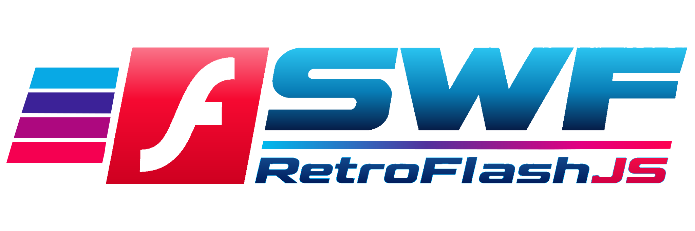
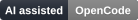

# RetroFlash.js

<p align="center">
  
</p>

[](https://github.com/ajsoriar/RetroFlash.js/actions/workflows/ci.yml)
[](./LICENSE)


> **Beta release:** `1.0.0-beta.2`. The player is usable, but its API and SWF compatibility may change before `1.0.0`. Review the [known limitations](./LIMITATIONS.md) before choosing it for a project.

**RetroFlash.js** is an open-source Flash SWF player and ActionScript runtime designed to bring classic Flash content back to life in modern web browsers. Built entirely with vanilla JavaScript and HTML5 Canvas, it aims to reproduce original Flash animations, interactive applications, and games without requiring plugins, WebAssembly, or external dependencies. Its primary goal is to provide a lightweight, self-contained, drop-in replacement for the original Flash Player, allowing existing SWF content to run with minimal or no changes to the original HTML markup.

## Why RetroFlash.js?

**A lightweight, dependency-free Flash SWF player and ActionScript runtime, built entirely in JavaScript and HTML5 Canvas.**

Bringing classic Flash animations and games back to modern browsers — without plugins, WebAssembly, or native dependencies.

RetroFlash.js is built around a simple idea: **preserve the original Flash experience with as little complexity as possible.**

- **100% Pure JavaScript** — No WebAssembly, native binaries, or browser plugins.
- **Zero Dependencies** — No external runtime libraries or frameworks.
- **Drop-in Replacement** — Just import the script. Keep your existing Flash `<object>` and `<embed>` elements.
- **Single-File Distribution** — One JavaScript file. No additional runtime assets.
- **HTML5 Canvas Rendering** — Native browser rendering without requiring WebGL.
- **No Build Tools Required** — No npm, bundlers, or compilation needed to use the player.
- **Legacy-Friendly** — Designed to preserve original HTML markup, FlashVars, dimensions, and playback parameters.
- **Self-Hosted & Offline-Ready** — No CDNs, cloud services, or external runtime connections.
- **Modular Architecture** — Separate SWF parser, rendering engine, audio decoders, and ActionScript runtime.
- **Developer-Friendly** — Readable, inspectable, and debuggable JavaScript.
- **Progressive Compatibility** — Incremental support for classic SWF features and ActionScript functionality.

### One script. No plugins. No WebAssembly.

**Just JavaScript bringing Flash back to life.**

*RetroFlash.js is under active development. SWF and ActionScript compatibility will expand progressively.*

## Non-Invasive Flash Recovery

RetroFlash.js restores legacy Flash content without asking developers to rewrite their original HTML, adopt a player-specific API, or modify their SWF files. Add the browser bundle to the page; RetroFlash.js detects legacy `<object>` and `<embed>` elements and plays them through Canvas.

An existing page can keep its Flash markup:

```html
<object
  data="game.swf"
  type="application/x-shockwave-flash"
  width="640"
  height="480">
  <param name="movie" value="game.swf">
  <param name="quality" value="high">
</object>
```

Add the bundle:

```html
<script src="node_modules/retroflash.js/dist/retroflash-1.0.0-beta.2.min.js"></script>
```

After publication, install the beta from npm with `npm install retroflash.js@beta`.

The browser bootstrap associates a Canvas player with each detected Flash element and carries over its dimensions and playback parameters. No manual changes to the legacy embed code or SWF files are required.

> **RetroFlash.js — Preserve the markup. Restore the experience.**

## What it supports

RetroFlash.js plays SWF animations on Canvas 2D:

- `DefineShape` 1–4: solid fills, linear, radial and focal gradients (pad, reflect, repeat), and lines, including gradient and bitmap line fills and non-scaling strokes;
- morph shapes (`DefineMorphShape`/`DefineMorphShape2`), drawn at each placement's ratio;
- 9-slice scaling (`DefineScalingGrid`);
- bitmaps:
  - `DefineBits` with `JPEGTables`;
  - `DefineBitsJPEG2/3/4` (JPEG, PNG, or GIF, and JPEG with an alpha plane);
  - `DefineBitsLossless/Lossless2`;
  - bitmap fills, clipped (with their edges extended) or repeating, and colour transforms on bitmaps;
- the display list, built from `PlaceObject`/`RemoveObject`;
- the timelines of the root movie and of nested `DefineSprite` instances;
- `clipDepth` masks;
- **text**:
  - `DefineText` drawn with the glyph outlines of `DefineFont`/`DefineFont2`/`DefineFont3`;
  - `DefineEditText` fields with embedded, device, or `DefineFont4` fonts, word wrap, alignment, margins, borders, `AutoSize`, and an HTML subset;
- **sound**: event sounds, button sounds and stream sounds in PCM, ADPCM and MP3, through Web Audio;
- **buttons** (`DefineButton`/`DefineButton2`): up/over/down states, hit areas, the hand cursor, and pointer and keyboard events with their actions;
- a controlled **AVM1 subset** for frame scripts and button actions. Browser interactions go through explicit host APIs; SWF-provided text is never evaluated as JavaScript. It covers:
  - timeline control: `stop`, `play`, `nextFrame`/`prevFrame`, `gotoAndPlay`/`gotoAndStop` by frame or label, and `tellTarget`/`setTarget`;
  - the stack, registers, and constant pool;
  - arithmetic, comparison, logical, string, and bitwise operators, with Flash Player's conversions for each SWF version;
  - timeline variables (`x = 5`, `_root.score`, `/clip:name`), which text fields bound to a variable display;
  - movie clips as values and their properties (`_x`, `_alpha`, `_visible`, `_currentframe`, …), `gotoAndPlay`/`gotoAndStop` with computed frames, `tellTarget` with computed targets, and `duplicateMovieClip`/`removeMovieClip`;
  - control flow: `if`/`else` and loops (bounded per frame), `return`, and `ifFrameLoaded`;
  - functions, closures, objects and arrays, classes (`new`, prototypes, `extends`, `super`), `with`, `try`/`catch`/`finally`, `for..in`, the built-in `Object`, `Array`, `String`, `Number`, `Boolean`, `Math` and `Error`, and the `MovieClip` methods (`_root.gotoAndPlay("label")`);
  - game APIs: clip events (`onClipEvent`, `onEnterFrame`, `onPress`, …), `Key` and `Mouse` with listeners, timers (`setInterval`, `getTimer`), dragging, `hitTest`, `attachMovie`, `createEmptyMovieClip`, `swapDepths`, `Color`, `Stage`, `Sound` (library sounds and `loadSound`), and `DoInitAction`;
  - `loadMovie`, `unloadMovie`, and `loadVariables` into clips: other SWF files and JPEG, PNG, or GIF images. The host page gives them through the `loader` option; legacy `<object>`/`<embed>` markup in the bundle gets a browser loader automatically, under CORS.

The `tests/fixtures/valid/fws-game.swf` mini game (a hero moved with the arrow keys, a score) plays in the player. What is not supported yet, such as editable input fields, filters, blend modes, video, and ActionScript 3, is listed in [`LIMITATIONS.md`](./LIMITATIONS.md) and reported at run time in `getDiagnostics().unsupported`.

The code lives in [`src/`](./src/) as classic scripts with no dependencies:

| File | Role |
|---|---|
| `src/swf-reader.js` | Parser (`SWFReader`, v0.6.0): FWS and CWS, a bounds-checked tag index, decoded placements, shapes, bitmap headers, fonts and text, buttons, filter lists, clip actions, and exports, and `inflate` |
| `src/core/`, `src/display/`, `src/text/`, `src/avm1/`, `src/audio/`, `src/input/`, `src/render/`, `src/browser/` | Player modules, including automatic playback of legacy Flash markup |
| `src/retroflash.js` | Player API (`RetroFlash`, v1.0.0-beta.2) |
| `src/modules.json` | The load order of every script above |

For use, build the single file `dist/retroflash-1.0.0-beta.2.min.js`, which holds the reader and the player (see [Build](#build)):

```html
<canvas id="stage"></canvas>
<input id="file" type="file" accept=".swf">
<script src="dist/retroflash-1.0.0-beta.2.min.js"></script>
<script>
  const player = new RetroFlash.Player({ canvas: document.getElementById('stage') });
  document.getElementById('file').addEventListener('change', async (event) => {
    await player.load(event.target.files[0]);
    player.play();
  });
</script>
```

During development, the source scripts can be loaded directly instead, in the order of `src/modules.json`. The demos do this, so they open directly, with no server and no build:

- [`demo/player.html`](./demo/player.html): the player;
- [`demo/index.html`](./demo/index.html): the structure inspector.

See [`LIMITATIONS.md`](./LIMITATIONS.md) for current compatibility gaps.

## Requirements

- **Playback:** a browser with Canvas 2D. Web Audio is optional and is used when available. Browser security rules, including CORS, govern external SWF and resource loads.
- **Build and tests:** Node.js 16 or later. Building the minified bundle also requires `npm install` for the development-only Terser dependency; the player has no runtime dependencies.

## Tests

```sh
node tests/run.js
```

Requires Node 16 or later and installs nothing. `npm run test:dist` builds the bundle and runs the same tests against it. The fixtures are generated by the project itself, in [`tests/fixtures/`](./tests/fixtures/). What is verified, and how, is listed in [`tests/COMPATIBILITY.md`](./tests/COMPATIBILITY.md).

```sh
npm run corpus -- some.swf folder/   # compatibility matrix by layer (parser, vm, api, render, input)
node tools/corpus.js --versions      # version-dependent AVM1 rules, SWF 4 to 10
```

Run the corpus only on SWF files you are allowed to use, and never commit third-party files.

## Build

```sh
npm install      # once: installs terser, the only development dependency
npm run build
npm run test:dist
```

The build ([`tools/build.js`](./tools/build.js)) minifies the scripts of `src/modules.json`, in order, into a versioned file with [terser](https://terser.org/), with a source map that points back to `src/`. The filename uses the package version from `package.json`; the build checks that it matches `RetroFlash.version`. Before anything is written, the sources and the bundle are each loaded in an isolated context. The current minified bundle and source map in `dist/` are committed, and CI checks that they match the sources. The bundle has no runtime dependencies.

The tests and the demos do not need `npm install`.

## Changelog

See [`CHANGELOG.md`](./CHANGELOG.md).

## License

RetroFlash.js is released under the [MIT License](./LICENSE).

## AI-Assisted Development

This project was developed extensively using AI-assisted coding tools, including **ChatGPT, OpenAI Codex, Anthropic Claude, GitHub Copilot, OpenCode, and DeepSeek**, integrated into **Visual Studio Code**.

AI was primarily responsible for generating source code, implementation details, and documentation, under human direction and supervision.

<p align="center">
  
  &nbsp;&nbsp;
  
  &nbsp;&nbsp;
  
  &nbsp;&nbsp;
  
  &nbsp;&nbsp;
  
  &nbsp;&nbsp;
  
</p>
